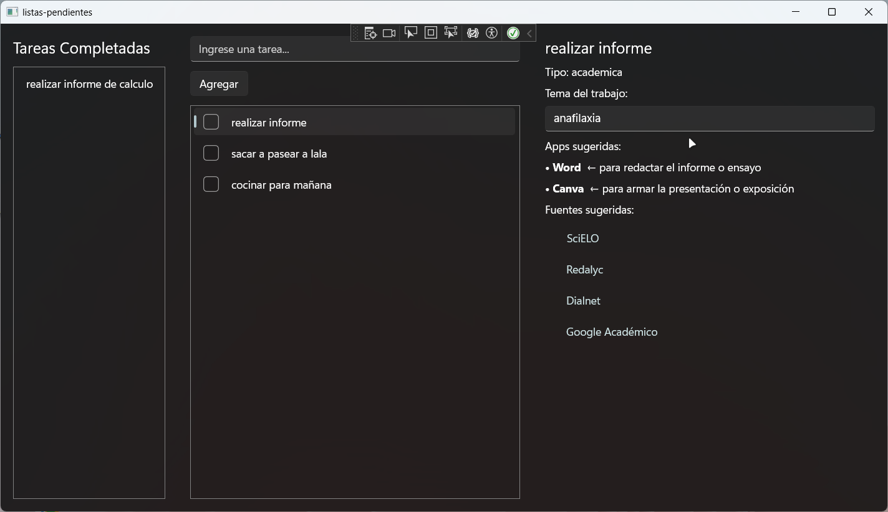
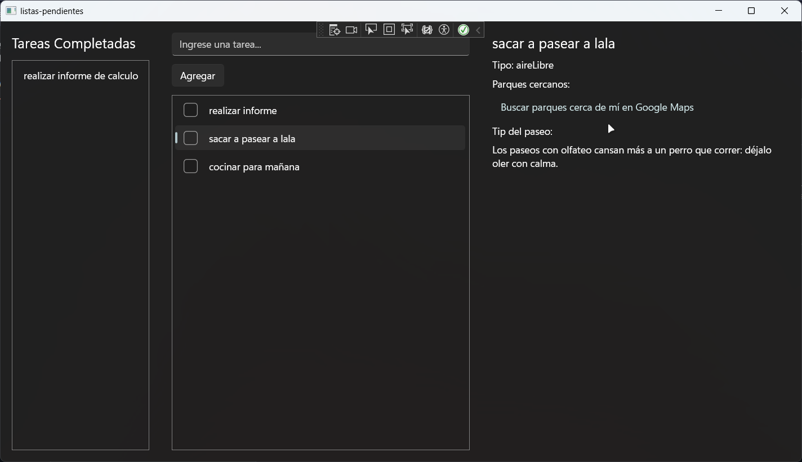
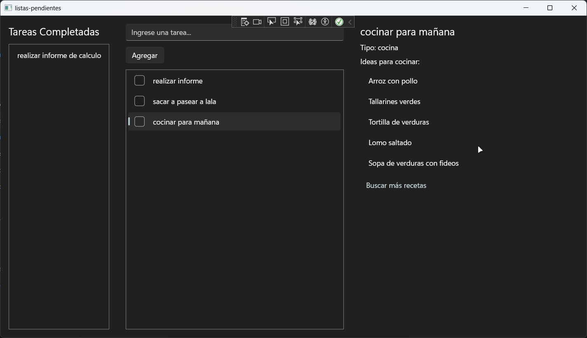
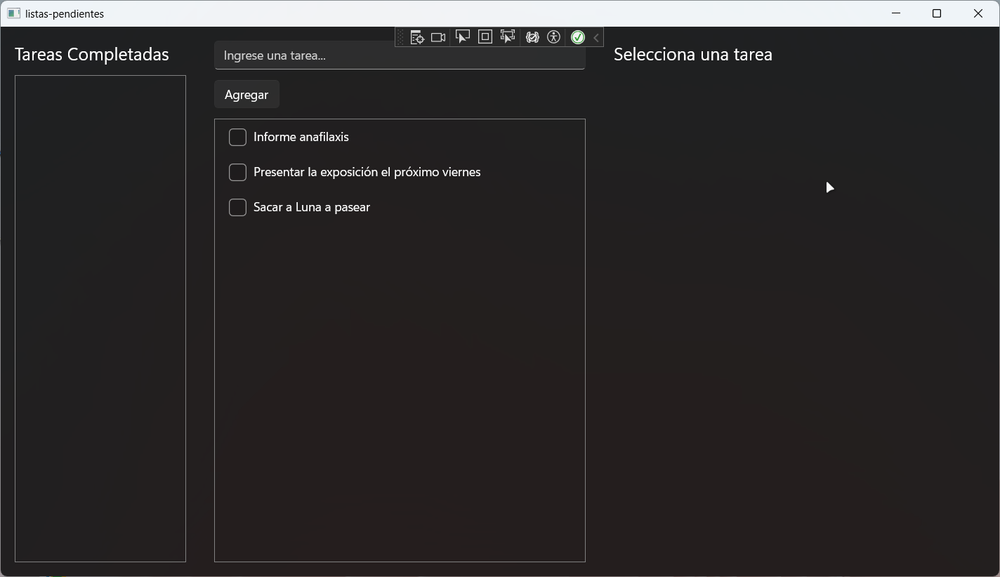
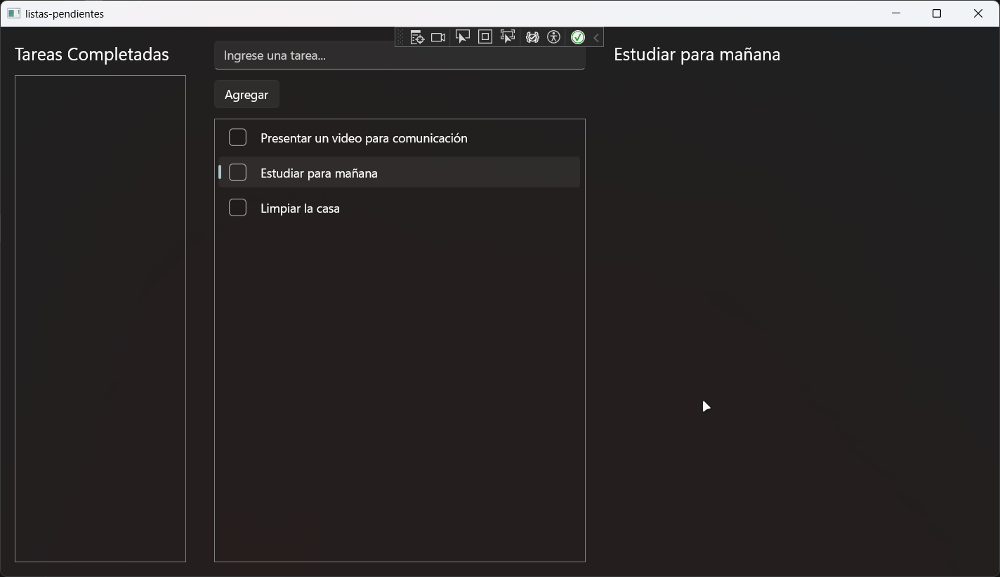
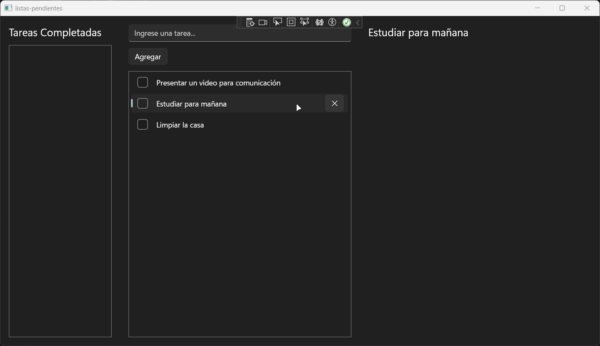

# Lista de pendientes con panel inteligente

Aplicación de escritorio para Windows (WinUI 3, C#) que guarda tareas pendientes y, al seleccionar una, muestra a la derecha un panel de ayuda según el tipo de tarea.

## Capturas

### Versión 2: paneles según el tipo de tarea

### Versión 1: lista de pendientes y completadas

## Problema
Las apps de pendientes solo guardan una lista; no ayudan a hacer la tarea.

## Estado actual
**Versión 2 terminada.** La app detecta el tipo de tarea y muestra un panel distinto para cada uno.

## Qué hace

### Versión 1: lista de tareas
- Agregar una tarea escribiendo su nombre.
- Marcar una tarea con el check: pasa a la columna "Tareas Completadas".
- Eliminar una tarea con la X, que solo aparece al pasar el mouse sobre la fila.
- Seleccionar una tarea (clic en su nombre) y ver su título en el panel derecho.
- Guardar automáticamente después de cada cambio y cargar las tareas al abrir la app.

### Versión 2: panel según el tipo de tarea
La app detecta el tipo de tarea por **palabras clave** en su nombre y muestra el panel que corresponde:

| Tipo | Ejemplo | Qué muestra el panel |
|---|---|---|
| Académica | "Informe de anafilaxia" | Recuadro para escribir el tema (se guarda con cada tarea), apps sugeridas con su motivo y lista de fuentes confiables |
| Aire libre | "Sacar a pasear al perro" | Enlace a parques cercanos en Google Maps y un tip al azar |
| Cocina | "Cocinar la cena" | Ideas de recetas y enlace para buscar más |
| General | "Comprar pilas" | Ningún panel |

Las fuentes y las recetas son por ahora **datos de ejemplo**. La búsqueda real llega en la Versión 3.

## Versiones planeadas
| Versión | Qué incluye |
|---|---|
| 1 | Lista de pendientes y completadas con guardado automático (terminada) |
| 2 | Detección del tipo por palabras clave y paneles académico, aire libre y cocina (terminada) |
| 3 | Búsqueda de fuentes por API, elegir modelo de IA con API key propia, detección del tipo por IA, parques y recetas reales |
| 4 | Rediseño de la interfaz |

## Cómo está organizado el código
| Archivo | Qué contiene |
|---|---|
| `MainWindow.xaml` | El diseño: 3 columnas (completadas, pendientes con caja y botón, panel derecho con sus paneles) |
| `MainWindow.xaml.cs` | Lo que hace cada botón y evento de la ventana, y qué panel se muestra |
| `Tarea.cs` | Las clases `Tarea` (nombre, completada, tema) y `Fuente` (título y enlace) |
| `detector_tipo.cs` | Clase estática que detecta el tipo de tarea por palabras clave |
| `almacen_tareas.cs` | Clase estática con `Guardar` y `Cargar` (archivo JSON) |

### Funciones principales
| Función | Qué hace |
|---|---|
| `BotonAgregar_Click` | Crea una tarea con el texto de la caja y la agrega a pendientes |
| `BotonCompletar_Click` | Pasa la tarea marcada de pendientes a completadas |
| `BotonEliminar_Click` | Quita la tarea de su fila |
| `Fila_PointerEntered` / `Fila_PointerExited` | Muestran y ocultan la X al pasar el mouse |
| `ListaTareas_SelectionChanged` | Detecta el tipo de la tarea elegida y muestra su panel |
| `CajaTema_TextChanged` | Guarda el tema que escribes en la tarea académica elegida |
| `detector_tipo.Detectar` | Devuelve el tipo de tarea (`General`, `Academica`, `AireLibre` o `Cocina`) según sus palabras clave |
| `GuardarTodo` | Junta pendientes y completadas y las guarda |
| `almacen_tareas.Guardar` / `Cargar` | Escriben y leen `tareas.json` en la carpeta local de la app |

## Limitaciones conocidas
- El detector solo busca palabras clave: no entiende la frase completa y no reconoce palabras sin tilde ("exposicion"). La detección por IA llega en la Versión 3.
- El enlace de parques abre Google Maps en el navegador; no hay mapa dentro de la app.

## Tecnologías
- C# y WinUI 3 (Windows App SDK)
- ObservableCollection para que la lista se actualice sola
- JSON (System.Text.Json) para guardar las tareas

## Cómo ejecutarlo
1. Instala Visual Studio con la carga de trabajo **Desarrollo de escritorio con .NET** y los **Windows App SDK C# Templates**.
2. Clona este repositorio y abre el archivo `.sln`.
3. Presiona el botón verde **Iniciar**.

## Autora
Yanta (GitHub: [yanlogic](https://github.com/yanlogic))
