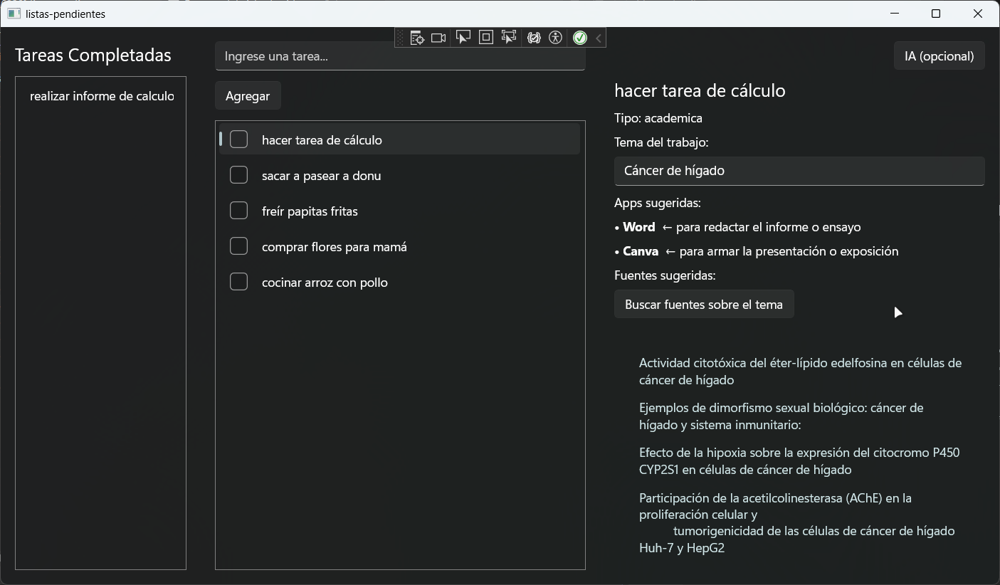
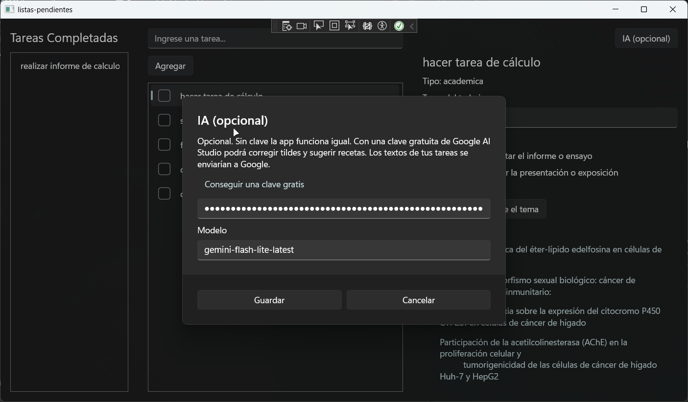
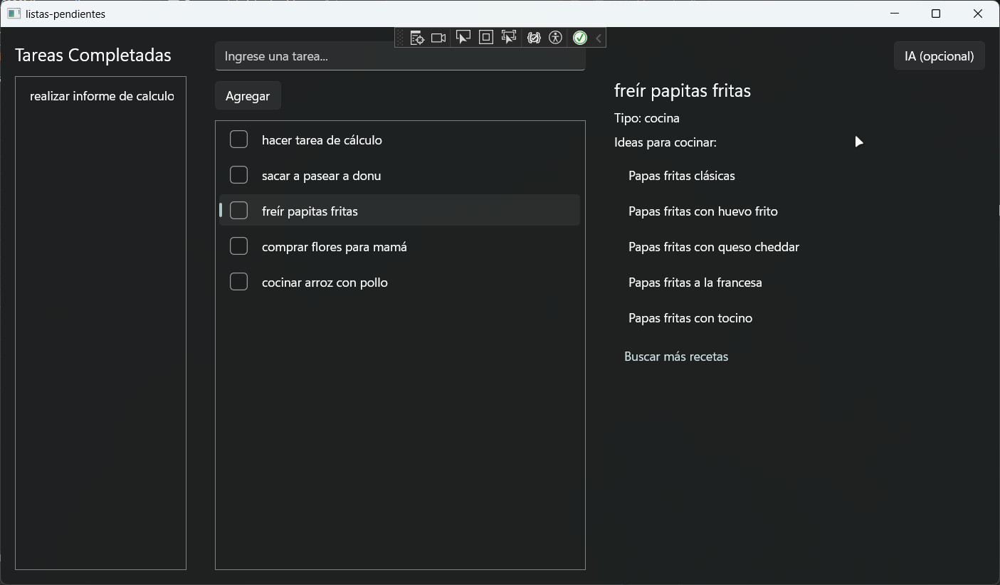

# Lista de pendientes con panel inteligente

Aplicación de escritorio para Windows (WinUI 3, C#) que guarda tareas pendientes y, al seleccionar una, muestra a la derecha un panel de ayuda según el tipo de tarea. Funciona sin configurar nada y, de forma opcional, mejora con una clave gratuita de IA.

## Capturas

### Versión 3: fuentes reales e IA opcional

### Versión 2: paneles según el tipo de tarea

### Versión 1: lista de pendientes y completadas

## Problema
Las apps de pendientes solo guardan una lista; no ayudan a hacer la tarea.

## Estado actual
**Versión 3 terminada.** La app busca artículos académicos reales sin pedir ninguna configuración. La IA es opcional.

## Qué hace

### Versión 1: lista de tareas
- Agregar una tarea escribiendo su nombre.
- Marcar una tarea con el check: pasa a la columna "Tareas Completadas".
- Eliminar una tarea con la X, que solo aparece al pasar el mouse sobre la fila.
- Seleccionar una tarea (clic en su nombre) y ver su título en el panel derecho.
- Guardar automáticamente después de cada cambio y cargar las tareas al abrir la app.

### Versión 2: panel según el tipo de tarea
La app detecta el tipo de tarea por **palabras clave** en su nombre y muestra el panel que corresponde:

| Tipo | Ejemplo | Qué muestra el panel |
|---|---|---|
| Académica | "Informe de anafilaxia" | Recuadro para el tema (se guarda con cada tarea), apps sugeridas con su motivo y lista de fuentes |
| Aire libre | "Sacar a pasear al perro" | Enlace a parques cercanos en Google Maps y un tip al azar |
| Cocina | "Cocinar la cena" | Ideas de recetas y enlace para buscar más recetas según la tarea |
| General | "Comprar pilas" | Ningún panel |

### Versión 3: fuentes reales e IA opcional
**Sin configurar nada:**
- El botón **Buscar fuentes sobre el tema** consulta [Crossref](https://www.crossref.org/) (base abierta de artículos académicos, sin clave) y muestra 5 artículos con enlace.

**Con una clave gratuita de Google AI Studio (opcional):**
- Corrige las tildes del tema antes de buscar, porque Crossref busca las letras tal cual se escriben.
- Clasifica el tipo de tarea cuando las palabras clave no la reconocen.
- Sugiere recetas en español según la tarea de cocina.
- Los resultados de la IA se guardan en la tarea: se consulta una sola vez por tarea. Sin clave, la app usa las palabras clave y las ideas de ejemplo.

## Privacidad
- La clave de IA se guarda en la caja fuerte de Windows (`PasswordVault`), no en el código ni en el archivo de tareas.
- Si activas la IA, el **nombre de tus tareas y el tema** se envían a Google. Revisa las condiciones del plan gratuito de Google AI Studio antes de usarlo con información personal.
- Las tareas se guardan solo en tu computadora.

## Versiones
| Versión | Qué incluye |
|---|---|
| 1 | Lista de pendientes y completadas con guardado automático |
| 2 | Detección del tipo por palabras clave y paneles académico, aire libre y cocina |
| 3 | Fuentes reales (Crossref) e IA opcional: tildes, tipo de tarea y recetas |
| 4 | Rediseño de la interfaz (planeado) |

## Cómo está organizado el código
| Archivo | Qué contiene |
|---|---|
| `MainWindow.xaml` | El diseño: 3 columnas (completadas, pendientes con caja y botón, panel derecho con sus paneles) |
| `MainWindow.xaml.cs` | Lo que hace cada botón y evento, y qué panel se muestra |
| `Tarea.cs` | Las clases `Tarea` (nombre, completada, tema, tipo detectado, recetas) y `Fuente` (título y enlace) |
| `detector_tipo.cs` | Detecta el tipo de tarea por palabras clave |
| `buscar-fuentes.cs` | Busca artículos en Crossref |
| `servicio_ia.cs` | Llamadas a la IA: corregir tildes, clasificar el tipo y sugerir recetas |
| `configuracion.cs` | Guarda la clave (caja fuerte de Windows) y el modelo elegido |
| `almacen_tareas.cs` | Guarda y carga las tareas en un archivo JSON |

## Limitaciones conocidas
- Crossref reúne artículos de revistas de todo el mundo: muchos títulos salen en inglés y no son "páginas web confiables" en general.
- La corrección de tildes solo funciona con la IA activada. Sin ella, buscar "cancer de higado" da resultados poco relacionados.
- La IA puede equivocarse al clasificar una tarea o dar recetas que no te gusten. Todavía no hay botón para corregir el tipo ni para pedir otras recetas.
- Los límites del plan gratuito de IA y los nombres de los modelos cambian con el tiempo. El modelo se puede editar en la configuración.
- El enlace de parques abre Google Maps en el navegador; no hay mapa dentro de la app.
- El diseño todavía es básico: se mejora en la Versión 4.

## Tecnologías
- C# y WinUI 3 (Windows App SDK)
- ObservableCollection para que la lista se actualice sola
- System.Text.Json para guardar tareas y leer respuestas de internet
- HttpClient con async/await para las consultas a Crossref y a la IA
- PasswordVault y LocalSettings de Windows para la configuración

## Cómo ejecutarlo
1. Instala Visual Studio con la carga de trabajo **Desarrollo de escritorio con .NET** y los **Windows App SDK C# Templates**.
2. Clona este repositorio y abre el archivo `.sln`.
3. Presiona el botón verde **Iniciar**.
4. (Opcional) Toca **⚙ IA (opcional)** para pegar una clave gratuita de [Google AI Studio](https://aistudio.google.com/apikey).

## Autora
Yanta (GitHub: [yanlogic](https://github.com/yanlogic))
